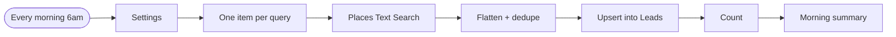
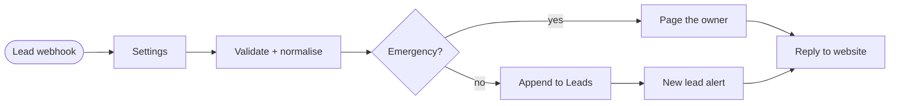
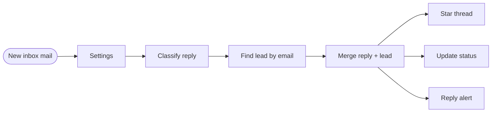
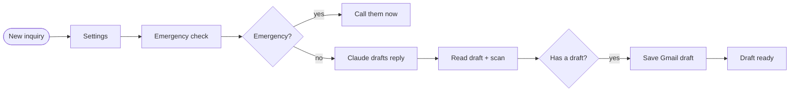
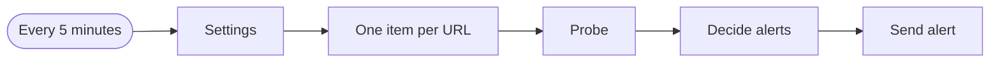

# n8n-automation-workflows

**Five importable n8n workflows for a small service business**, built to be safe to leave running: they dedupe, alert once instead of forty times, keep emergencies away from the AI, and never send an AI-written email without a person pressing Send. The JavaScript inside every Code node is unit-tested outside n8n.

> Part of the [AutoNexus Labs](https://autonexuslabs.com) automation portfolio. Credentials, sheet ids and chat ids are placeholders.

| # | Workflow | Trigger | Does |
|---|---|---|---|
| 01 | [Local business leads → Google Sheets](workflows/01-local-business-leads-to-sheets.json) | every morning | Google Places (official API) → flatten, dedupe across queries, drop closed → upsert by `placeId` → Telegram summary |
| 02 | [Website lead → CRM sheet + Telegram](workflows/02-website-lead-to-crm.json) | webhook | validate and normalise the form or chat payload → **emergency? page the owner now** : append to Leads + alert → always answer the website |
| 03 | [Lead replied → star + update sheet + Telegram](workflows/03-lead-replied-gmail.json) | Gmail, every 5 min | skip bounces and out-of-office → match the sender against Leads → star the thread, set **Replied** or **Do not contact**, send the reply text to Telegram |
| 04 | [Customer email → Claude draft → review in Gmail](workflows/04-ai-reply-drafts-gmail.json) | Gmail label, every 5 min | emergency check first → Claude drafts from your business facts → code scan for prices, guarantees, time promises → **saved as a Gmail draft in the thread**, never sent |
| 05 | [Uptime watchdog → Telegram](workflows/05-uptime-watchdog.json) | every 5 min | probe URLs → state in workflow static data → alert once when down (2 failures in a row), once when back up, with downtime |

## The flows

Click to expand. Diagrams are generated from each workflow's own connections.

<details><summary><b>01 · Local business leads → Google Sheets</b></summary>



</details>

<details><summary><b>02 · Website lead → CRM sheet + Telegram</b></summary>



</details>

<details><summary><b>03 · Lead replied → star + update sheet + Telegram</b></summary>



</details>

<details><summary><b>04 · Customer email → Claude draft → review in Gmail</b></summary>



</details>

<details><summary><b>05 · Uptime watchdog → Telegram (alerts on change)</b></summary>



</details>

## Why these are built the way they are

**A Settings node at the start of each workflow.** The sheet id, Telegram chat id, queries, model name and business facts live in one Set node. Nothing is hard-coded in five different places, and the workflow can be handed over by editing one node.

**Idempotent writes.** Workflow 01 uses *append or update* matched on `placeId`, so running it twice (or after a crash) never duplicates a lead. Workflow 03 updates the existing row by email instead of appending.

**Emergencies skip the queue and the model.** In 02 and 04, messages mentioning a gas smell, carbon monoxide, smoke or sparks go straight to a Telegram page for the owner. The AI is never asked to improvise safety advice.

**AI output is checked by code.** Workflow 04 asks Claude to answer through a tool (structured output: intent, draft, needs_human), then a Code node scans the draft. A dollar amount, "guarantee" or "within 2 hours" marks it as needing a person. The result is a Gmail **draft** in the original thread: the owner reads it, edits it, presses Send.

**Order-sensitive reply classification.** Workflow 03 knows that "I'll stop by the office" is not an opt-out, that a bare "STOP" is one, and that the quoted "reply stop to opt out" under `On ... wrote:` is not the customer's words.

**No alert spam.** Workflow 05 keeps per-URL state in `$getWorkflowStaticData('global')`, with no database. One failed probe is not an outage, and a two-hour outage sends two messages, not twenty-four.

## Tested outside n8n

```text
$ npm test

✔ every workflow is structurally valid
✔ every Code node is valid JavaScript
✔ 01 · Places results are flattened, deduped across queries, closed ones dropped
✔ 02 · website lead is cleaned and emergencies are flagged
✔ 03 · only human replies pass, opt-outs are recognised, "stop by" is not one
✔ 04 · the draft is scanned for prices, guarantees and time promises
✔ 04 · emergencies are caught before the model
✔ 05 · watchdog alerts once on the way down and once on the way up
ℹ pass 8
```

The test extracts each Code node's JavaScript from the workflow JSON and runs it against n8n-shaped stubs (`$input`, `$('Node name')`, `$getWorkflowStaticData`). It also checks that every connection points at a real node and that no real credential id was committed.

## Import

1. In n8n: **Workflows → Import from file**, pick a JSON from `workflows/`.
2. Open the **Settings** node and fill in your ids.
3. Open each node with a credential warning and pick or create the credential:

| Credential | Used by |
|---|---|
| Google Sheets OAuth2 | 01, 02, 03 |
| Gmail OAuth2 | 03, 04 |
| Telegram API (bot token from @BotFather) | all |
| HTTP Header Auth, name `X-Goog-Api-Key` | 01 (Google Places API key) |
| HTTP Header Auth, name `x-api-key` | 04 (Anthropic API key) |

4. Workflows 01 and 03 expect a **Leads** tab whose header row includes the columns they write (`placeId`, `name`, `phone`, `website`, `email`, `status`...). Workflow 04 expects a Gmail label **Inquiries**.
5. Test with **Execute workflow**, then activate. Workflow 05's state only persists while it is active.

Written against n8n 2.x node versions. The tests check structure and the Code-node logic; node settings that talk to Google, Gmail, Telegram or Anthropic can only be proven with live credentials, so run each workflow once with **Execute workflow** before activating it.

## Related code projects

The same ideas as standalone Node.js projects: [business-lead-scraper](https://github.com/autonexuslabs/business-lead-scraper) · [ai-chat-widget](https://github.com/autonexuslabs/ai-chat-widget) · [gmail-reply-tracker](https://github.com/autonexuslabs/gmail-reply-tracker) · [ai-reply-drafter](https://github.com/autonexuslabs/ai-reply-drafter) · [telegram-watchdog](https://github.com/autonexuslabs/telegram-watchdog)

## Built by

[AutoNexus Labs](https://autonexuslabs.com): AI automation, lead pipelines and data tooling for small businesses. n8n Foundations: [N8N101](https://badges.n8n.io/d2be139c-0938-49cc-bb5f-c8b48d42b583) · [N8N102](https://badges.n8n.io/55f72afe-d9e2-4398-9a9f-2c457888d8e3) · [N8N103](https://badges.n8n.io/44df8277-2ede-4932-8ce0-82513143e062).
Need an n8n workflow built or fixed? Email **contact@autonexuslabs.com**.

## License

MIT
